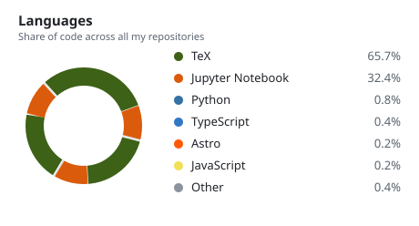

### Hi, I'm Jerry

I study physics at UCL. Most of my work lives in Python, Jupyter notebooks and LaTeX, from lab data analysis to gamma-ray spectroscopy with HPGe detectors. You can find more about me at [jerry-chen.org](https://jerry-chen.org).

<picture>
  <source media="(prefers-color-scheme: dark)" srcset="languages-dark.svg">
  
</picture>

The chart counts code in all of my repositories and is redrawn weekly by a small workflow in this repository.
