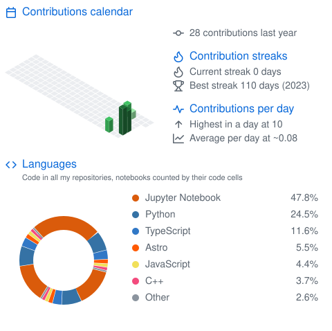

### Hi, I'm Jerry

<picture>
  <source media="(prefers-color-scheme: dark)" srcset="card-dark.svg">
  
</picture>

The card is redrawn daily by a small workflow in this repository. The calendar shows public contributions, and the languages count code in all of my repositories. The calendar design is inspired by [lowlighter/metrics](https://github.com/lowlighter/metrics), and the icons are [Primer Octicons](https://github.com/primer/octicons). Both are MIT licensed, see [NOTICE](NOTICE).
